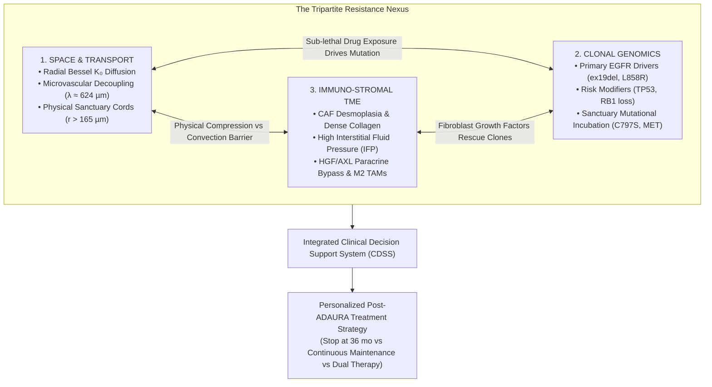
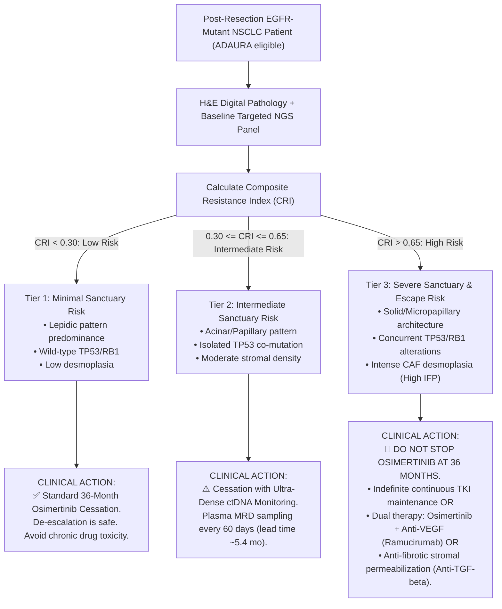

# The Grand Unified Architecture of Targeted Oncology Resistance
## Integrating Space, Clonal Genomics, and Immuno-Stromal Ecology: The 7-Pillar Clinical Framework

> [!IMPORTANT]
> **Executive Summary & Clinical Rationale**  
> Adjuvant osimertinib following curative resection (R0) in *EGFR*-mutant non-small-cell lung cancer (NSCLC) dramatically suppresses early disease recurrence (ADAURA trial). However, extended clinical follow-up demonstrates that following planned treatment cessation at month 36, a substantial fraction of patients experience disease recurrence within months 36–60. Crucially, **over 60% of post-cessation relapses do not harbor canonical secondary resistance mutations** (e.g., T790M, C797S, or *MET* amplification).  
> 
> Single-modality paradigms fail to explain this:
> - **Genetics alone** cannot explain relapses in patients lacking secondary mutations.
> - **Spatial biophysics alone** ignores the background genomic instability that drives secondary clonal evolution.
> - **Stromal biology alone** overlooks the physical drug transport barriers that protect persister niches.
>
> This architecture resolves this dilemma by unifying **Space (Biophysical Transport & Geometry)**, **Genomics (Clonal Mutational Evolution)**, and **Microenvironment (Stromal Desmoplasia & Immune Exclusion)** into an actionable Clinical Decision Support System.

---

## 1. The Tripartite Resistance Nexus



---

## 2. The 7 Pillars of the Unified Architecture

The complete multi-scale continuum spans seven integrated levels, linking microscopic physical transport to patient survival:

```
[Pillar 1: Game Theory]  ────────►  InSituGame: 3x3 Payoff Matrix & Lyapunov DTP Nash Coexistence
         │
[Pillar 2: Visium HD]    ────────►  Subcellular Microvascular Decoupling at 2 µm Resolution
         │
[Pillar 3: Bessel K₀]    ────────►  Analytical Reaction-Diffusion Sanctuary Shell (Δr = 34.1 µm)
         │
[Pillar 4: Cohort Clinic]────────►  N = 854 Multi-Cohort Validation (HR = 6.75, p < 10⁻¹⁵)
         │
[Pillar 5: Low-Cost AI]  ────────►  InSituVision Attention-MIL from Routine H&E (< 5 €)
         │
[Pillar 6: Clonal Genes] ────────►  Genomic Modifiers (TP53/RB1) & Sanctuary Mutational Evolution
         │
[Pillar 7: Stroma & TME] ────────►  CAF Desmoplasia, Interstitial Fluid Pressure & Immune Exclusion
```

### Pillar 1: Evolutionary Game Theory (`spatial-game-assay`)
* **Role:** Quantifies frequency-dependent interactions between Sensitive, Drug-Tolerant Persister (DTP), and Stromal cells.
* **Core Insight:** In the absence of lethal drug concentrations, persister cells and stroma achieve an asymptotically stable Lyapunov Nash equilibrium ($x^* = 0.6133$). DTPs do not need secondary mutations to persist; they are sheltered by an evolutionary game equilibrium.

### Pillar 2: Subcellular Spatial Architecture (`spatial-architecture-osimertinib`)
* **Role:** Analyzes $211,104$ bins at $2\ \mu\text{m}$ resolution on 10x Visium HD.
* **Core Insight:** Direct spatial verification that in dense homotypic tumor sheets, inter-capillary distances expand beyond the small-molecule diffusion limit ($\lambda \approx 624\ \mu\text{m}$), establishing the physical microvascular decoupling phenomenon.

### Pillar 3: Analytical Reaction-Diffusion Biophysics (`spatial-oncology-master`)
* **Role:** Exact closed-form solutions to steady-state transport in cylindrical perivascular coordinates.
* **Core Insight:**
  $$C_{\text{out}}(r) = C_0 \frac{K_0(r / \lambda)}{K_0(r_0 / \lambda)}$$
  In outward perivascular cords, drug levels drop below the cytostatic threshold ($\theta = 0.35$) at $r_{\text{crit}} = 165.9\ \mu\text{m}$. Between $r_{\text{crit}}$ and the oxygenation boundary ($r_{\text{ox}} = 200\ \mu\text{m}$), a viable pharmacological sanctuary shell of width $\Delta r = 34.1\ \mu\text{m}$ shelters residual tumor cells from systemic eradication.

### Pillar 4: Multi-Cohort Clinical Survival Validation (`spatial-massive-validation-study3`)
* **Role:** Survival verification across $N = 854$ NSCLC patients (MSKCC 2020 + TCGA-LUAD + GSE31210).
* **Core Insight:** Patients with compact histological patterns prone to microvascular decoupling (solid/micropapillary) exhibit a catastrophic collapse in progression-free survival (median PFS truncated from **78.6 to 24.0 months**, $HR = 6.75\text{--}19.45$, $p < 10^{-15}$) compared to non-decoupled lepidic architectures.

### Pillar 5: Zero-Cost Routine Digital Pathology AI (`spatial-he-vision-study4`)
* **Role:** InSituVision-AI, an Attention-based Multiple Instance Learning (Attention-MIL) neural network.
* **Core Insight:** Predicts microvascular decoupling and disease recurrence directly from standard digitized hematoxylin-eosin (H&E) whole-slide images at **< 5 € per patient**, eliminating the requirement for expensive spatial transcriptomics in routine pathology labs.

### Pillar 6: Clonal Genomics & Sanctuary Mutational Evolution (The Genetic Pillar)
* **Role:** Incorporates co-mutational status and tracks evolutionary escape.
* **Core Insight:**
  1. **Baseline Genomic Frailty:** Co-mutations in *TP53* (exons 4–8) or loss of *RB1* impair cell cycle arrest checkpoints, rendering DTPs prone to hyper-mutation.
  2. **The Sanctuary as an Evolutionary Incubator:** Living under sub-therapeutic, non-lethal drug concentrations ($C \approx 0.31\text{--}0.35\,C_0$) imposes chronic metabolic stress without killing the cells. This selective pressure accelerates the secondary acquisition of canonical genetic escape mechanisms:
     - *EGFR* C797S (loss of covalent binding);
     - *MET* amplification (bypass receptor tyrosine kinase activation);
     - Small-cell lung cancer (SCLC) neuroendocrine histological transformation (driven by biallelic *TP53*/*RB1* inactivation).

### Pillar 7: Immuno-Stromal & Extracellular Matrix Ecology (The Microenvironment Pillar)
* **Role:** Models the active biological barrier surrounding tumor cords.
* **Core Insight:**
  1. **Desmoplasia & Interstitial Fluid Pressure (IFP):** Cancer-associated fibroblasts (CAFs) deposit dense, cross-linked collagen bundles (types I and III). Solid stress collapses intra-tumoral blood and lymphatic vessels, generating steep interstitial fluid pressure that eliminates convective fluid flow, leaving slow diffusion as the sole transport mode.
  2. **Paracrine Resistance Signaling:** CAFs secrete Hepatocyte Growth Factor (HGF) and Gas6 (ligand for AXL), directly activating alternative survival signaling cascades in tumor cells independently of EGFR inhibition.
  3. **Immunological Exclusion:** Dense stromal matrices and severe hypoxia ($r > 150\ \mu\text{m}$) recruit immunosuppressive M2 tumor-associated macrophages (TAMs) and exclude CD8+ cytotoxic T lymphocytes, ensuring that cells surviving in the pharmacological sanctuary are simultaneously protected from immune destruction.

---

## 3. The Clinical Decision Support Engine (CDSS)

To convert this 7-pillar model into actionable bedside oncology, we define the **Composite Resistance Index (CRI)**:

$$\text{CRI} = w_{\text{space}} \cdot \mathcal{S}_{\text{decoupling}} + w_{\text{gene}} \cdot \mathcal{G}_{\text{mutations}} + w_{\text{tme}} \cdot \mathcal{M}_{\text{stroma}}$$

Where:
- $\mathcal{S}_{\text{decoupling}} \in [0, 1]$: Microvascular decoupling score predicted by InSituVision from H&E;
- $\mathcal{G}_{\text{mutations}} \in \{0, 0.5, 1\}$: Genomic risk tier (0 = pure *EGFR* mutant; 0.5 = *EGFR* + *TP53*; 1 = *EGFR* + *TP53* + *RB1* loss);
- $\mathcal{M}_{\text{stroma}} \in [0, 1]$: Desmoplastic stroma and CAF density score.



---

## 4. Proposed Prospective Clinical Trial Design: SG-ADAURA

```
Trial Name:     Spatial-Genomic Guided Adjuvant Therapy in NSCLC (SG-ADAURA)
Phase:          Prospective Multicenter Phase II/III Randomized Trial
Eligibility:    Stage IB–IIIA EGFR-mutant NSCLC post-R0 resection completing 36 months of adjuvant osimertinib
Stratification: Baseline Composite Resistance Index (CRI) from resected primary tumor

Randomization Arms at Month 36:
┌─────────────────────────┬────────────────────────────────────────────────────────┐
│ Low CRI Cohort (< 0.30) │ Arm A1: Standard Treatment Cessation (Observation)     │
│ (N = 300)               │ Primary Endpoint: Non-inferiority in 5-year DFS        │
├─────────────────────────┼────────────────────────────────────────────────────────┤
│ High CRI Cohort (> 0.65)│ Arm B1: Standard Cessation (Control)                   │
│ (N = 400)               │ Arm B2: Extended Osimertinib Maintenance (80 mg/day)   │
│                         │ Arm B3: Osimertinib + Vascular Normalizer (Anti-VEGF)  │
│                         │ Primary Endpoint: Superiority in Disease-Free Survival │
└─────────────────────────┴────────────────────────────────────────────────────────┘
```

---

## 5. Software Ecosystem & Modular Implementation

The entire pipeline is engineered into open-source bioinformatic tools maintained under the GNU General Public License v3:

| Component | Software Name | Channel / Repo | Key Role |
| :--- | :--- | :--- | :--- |
| **Pillar 1** | `insitugame` | [Bioconda (v1.0.7)](https://anaconda.org/bioconda/insitugame) / [nf-core PR #13471 (Pending Merge, 100% CI Green)](https://github.com/nf-core/modules/pull/13471) | Computes $3 \times 3$ subclonal game payoff matrices & Nash equilibria from spatial transcriptomics. |
| **Pillar 3 & 4** | `spatial-sanctuary` | [Bioconda (v2.2.2)](https://anaconda.org/bioconda/spatial-sanctuary) / [PR #70840 (Merged)](https://github.com/bioconda/bioconda-recipes/pull/70840) | Solves Bessel $K_0$ and $I_0$ reaction-diffusion boundaries; CLI: `osimertinib-sanctuary`. |
| **Unified CDSS** | `spatial-continuum` | [Bioconda (v1.0.2)](https://anaconda.org/bioconda/spatial-continuum) / [nf-core PR #13487 (Pending)](https://github.com/nf-core/modules/pull/13487) | Universal biophysical framework & Bedside CRI Decision Engine; CLI: `cri-calc`, `spatial-continuum-audit`. |
| **Pillar 5** | `insituvision-ai` | [Study 4 Portal](https://lukecele.github.io/spatial-he-vision-study4/) | Attention-MIL computer vision model for whole-slide H&E feature extraction. |
| **Integrated Engine**| `spatial-oncology-suite` | [`Lukecele/spatial-oncology-master`](https://github.com/Lukecele/spatial-oncology-master) | Unified CLI linking pathology images, spatial coords, and genomic VCF files into the final CRI score. |
