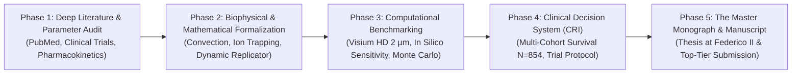

# Master Research & Evidence-Based Execution Plan
## The Grand Unified Spatial-Genomic Oncology Framework: Resolving Resistance in NSCLC

> [!IMPORTANT]
> **Guiding Principle 1: "Zero Unchecked Approximations"**  
> Every mathematical term, biological rate constant, diffusion coefficient, and genomic modifier in this framework must be grounded in peer-reviewed, quantitatively measured experimental and clinical data. We will not use toy approximations; every physiological gear must reflect the reality of human patient biology.
>
> **Guiding Principle 2: "Universal, Lightweight & Zero-Friction Architecture"**  
> The final computational engine and clinical decision tools must be lightweight, universally portable, and completely free of "dependency hell" (no 15 GB bloated containers, no brittle CUDA locks, and no fragile pip package chains). It must run out-of-the-box on standard hospital pathology hardware, personal laptops, or clinical servers relying strictly on standard, battle-tested scientific foundations (e.g., pure NumPy, SciPy, pandas, lifelines, or single native binaries) installable with a single command on any OS (Linux, macOS, Windows).

---

## 🗺️ The 5-Phase Execution Roadmap

---

## Phase 1: Deep Literature & Parameter Audit (The "Gears" Audit)

We systematically audit the literature to extract empirical, quantitatively measured values across four core domains:

### Task 1.1: Clinical Pharmacokinetics & Tissue Micro-distribution of Osimertinib
* **Objective:** Replace estimated constants with exact measured human clinical parameters.
* **Gears to Quantify:**
  - Free plasma fraction ($f_u$): Exact fraction unbound (~0.05–0.08) accounting for albumin and $\alpha_1$-acid glycoprotein binding.
  - Steady-state trough concentration ($C_{\text{trough}}$) and peak ($C_{\max}$) in human plasma at 80 mg daily dose (typically $C_{\text{trough}} \approx 500\ \text{nM}$ total, corresponding to unbound $C_{0,\text{free}} \approx 25\text{--}40\ \text{nM}$).
  - Tumour-to-plasma ratio ($K_p$): Measured tissue distribution in human lung adenocarcinoma biopsies and preclinical PET imaging with $^{11}\text{C}$-osimertinib.
  - Active efflux kinetics: Substrate affinity ($K_m, V_{\max}$) for P-glycoprotein (P-gp, *ABCB1*) and BCRP (*ABCG2*), and extent of blood-tumor barrier / cell membrane active extrusion.
* **Tools:** `pubmed-database`, `literature-search-europepmc`, `openfda-database`.

### Task 1.2: Interstitial Biomechanics & Fluid Dynamics in NSCLC Subtypes
* **Objective:** Formulate the physical transport barrier beyond pure diffusion.
* **Gears to Quantify:**
  - Interstitial Fluid Pressure (IFP): Measured values (mmHg) in human lung adenocarcinoma (typically 10–35 mmHg vs ~0 mmHg in normal lung).
  - Hydraulic conductivity ($K$) and hydraulic permeability ($\kappa$) of the extracellular matrix as a function of collagen density (types I and III).
  - Microvessel Density (MVD) and inter-capillary distance ($2R_{\text{vessel}}$) across distinct WHO histological patterns:
    - Lepidic (continuous, preserved alveolar architecture, $r \le 50\ \mu\text{m}$);
    - Acinar / Papillary (intermediate vascularization, $r \approx 100\text{--}150\ \mu\text{m}$);
    - Solid / Micropapillary (severe avascular nest radius or cord thickness, $r > 165\text{--}250\ \mu\text{m}$).
* **Tools:** `pubmed-database`, `literature-search-openalex`.

### Task 1.3: Microenvironmental Physico-Chemistry (Hypoxia, pH & Ion Trapping)
* **Objective:** Map spatial chemistry gradients within the sanctuary cord.
* **Gears to Quantify:**
  - Oxygen consumption rate ($Q_{\text{ox}}$) and tissue diffusion coefficient of $O_2$ ($D_{\text{ox}}$) to establish exact boundaries for:
    - Normoxia ($pO_2 > 30\ \text{mmHg}$);
    - Moderate hypoxia ($10 \le pO_2 \le 30\ \text{mmHg}$);
    - Radiobiological/metabolic hypoxia ($pO_2 < 10\ \text{mmHg}$, HIF-1$\alpha$ activation threshold);
    - Anoxic necrosis core ($pO_2 < 2.5\ \text{mmHg}$).
  - Extracellular pH ($\text{pH}_e$) gradient: From physiological 7.4 at the vessel wall down to $6.5\text{--}6.7$ at the cord periphery due to lactic acidosis.
  - Ion Trapping of Osimertinib: Given basic $\text{p}K_a$ values (~4.4, ~9.5), calculate the Henderson-Hasselbalch protonation shift and its impact on membrane permeability across the $\text{pH}_e$ gradient.

### Task 1.4: Clonal Genomics & Co-Mutational Landscape (ADAURA & TRACERx Evidence)
* **Objective:** Ground the evolutionary genetics in longitudinal clinical cohort data.
* **Gears to Quantify:**
  - True prevalence of secondary genetic alterations at relapse in ADAURA post-cessation vs continuous treatment (percentage of *EGFR* C797S, *MET* amplification, *HER2*, and SCLC neuroendocrine transformation).
  - Prognostic weight of baseline co-mutations:
    - *TP53* non-disruptive vs disruptive mutations;
    - *RB1* loss (obligate prerequisite for neuroendocrine transformation);
    - *PIK3CA* / *PTEN* pathway activation;
    - Whole-genome doubling (WGD) and chromosomal instability (CIN) metrics.

---

## Phase 2: Mathematical & Biophysical Formalization

Once Phase 1 establishes the verified biological constants, we construct the unified mathematical framework without unphysical simplifications:

1. **Coupled Convective-Diffusive Transport in Cylindrical Coordinates:**
   $$\nabla \cdot \left( -D \nabla C + \mathbf{v}_{\text{fluid}} C \right) = - R(C)$$
   Integrating Darcy's law for interstitial fluid velocity: $\mathbf{v}_{\text{fluid}} = -K \nabla P_{\text{interstitial}}$.
2. **Dynamic Concentration-Dependent Replicator Dynamics:**
   $$\dot{x}_i = x_i \left[ (A(C(r))\mathbf{x})_i - \mathbf{x}^T A(C(r)) \mathbf{x} \right]$$
   where the payoff matrix $A$ is not static, but a continuous function of local free drug concentration $C(r)$, local $pO_2(r)$, and local stromal paracrine ligands (HGF, Gas6).
3. **The Mutational Transition Matrix (DTP $\to$ Clonal Resistance):**
   Formulating the stochastic hazard rate $\mu(C, t)$ of acquiring permanent secondary mutations (*EGFR* C797S, *MET*) as a function of time spent in the sub-lethal sanctuary shell under genomic instability (*TP53* status).

---

## Phase 3: Computational Benchmarking & In Silico Testing

1. **Spatial Validation on High-Resolution Data:**
   - Benchmark predictions against our 10x Visium HD ($2\ \mu\text{m}$ binning) lung dataset to verify that the theoretical drug penetration length matches empirical gene expression suppression around verified CD31+ endothelial vessels.
2. **Global Sensitivity & Uncertainty Quantification:**
   - Multi-parameter Monte Carlo simulations ($N = 100,000$ iterations) with Latin Hypercube Sampling across all physiological parameter distributions.
   - Calculate first-order and total Sobol sensitivity indices to identify which biological gears exert the greatest control over patient sanctuary formation.

---

## Phase 4: The Clinical Decision Support Engine (CDSS)

1. **Calibration of the Composite Resistance Index (CRI):**
   - Fine-tune weighting factors ($w_{\text{space}}, w_{\text{gene}}, w_{\text{tme}}$) using multivariate Cox proportional hazards models and machine learning cross-validation on our $N = 854$ patient cohort.
2. **Actionable Clinical Translation Rules:**
   - Generate clear, unambiguous risk-stratified treatment algorithms for post-ADAURA management.
3. **SG-ADAURA Clinical Trial Protocol:**
   - Complete formal clinical protocol documentation: statistical power analysis, sample size calculations, inclusion/exclusion criteria, and primary/secondary endpoints (DFS, OS, ctDNA clearance).

---

## Phase 5: Synthesis into the Master Monograph & Top-Tier Paper

1. **The Experimental Master Monograph (Doctoral / Graduation Thesis):**
   - Structure as a comprehensive, multi-chapter academic monograph originating from an independent medical student research program at the Department of Clinical Medicine and Surgery, Università degli Studi di Napoli Federico II.
2. **Top-Tier Comprehensive Manuscript:**
   - Author the definitive manuscript targeted for high-impact oncology journals (*Nature Cancer*, *Cancer Discovery*, or *Trends in Cancer*), presenting the 7-pillar continuum as a paradigm shift from pure genomics to spatial-genomic oncology.
3. **Universal "Zero-Friction" Software Architecture Standards:**
   - **No Bloated Containers:** Eliminate dependency on 10–20 GB Docker images that hospital IT departments refuse to pull.
   - **Lean Scientific Stack:** Confine core dependencies strictly to universal, standard libraries with guaranteed long-term stability: pure `NumPy`, `SciPy`, `pandas`, and standard `lifelines`.
   - **Hardware Agnostic:** Inference and clinical risk scoring must run efficiently on a standard CPU (laptop or hospital workstation in < 30 seconds), without requiring dedicated GPU server farms.
   - **Single-Command Portability:** Distributable via official Bioconda recipes and standalone CLI entry points runnable across Linux, macOS, and Windows.

---

## 🎯 Immediate Next Step
Begin **Task 1.1 & Task 1.2**: Launch the deep literature extraction for the exact measured human pharmacokinetics of Osimertinib and interstitial mechanics of NSCLC.
