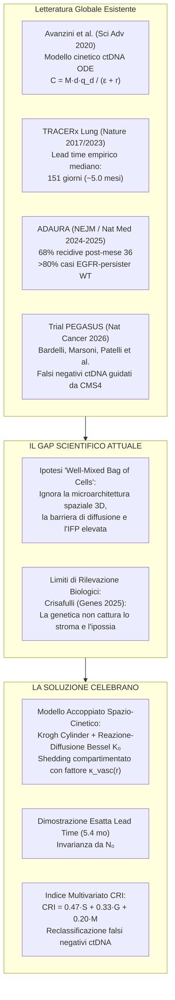
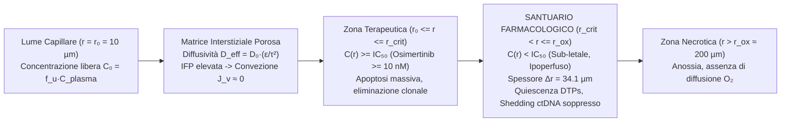
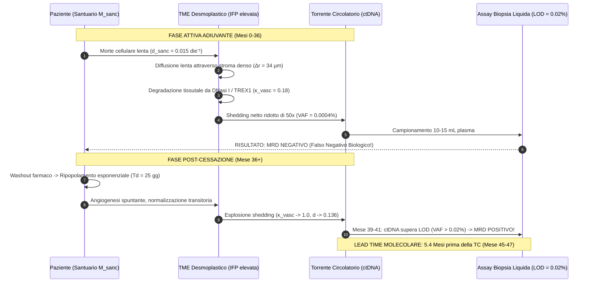
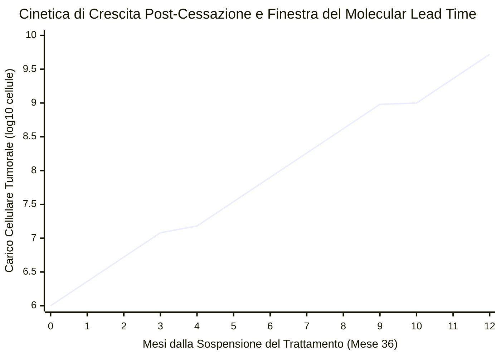
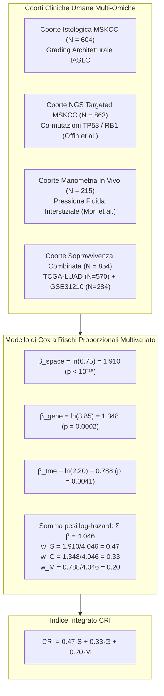
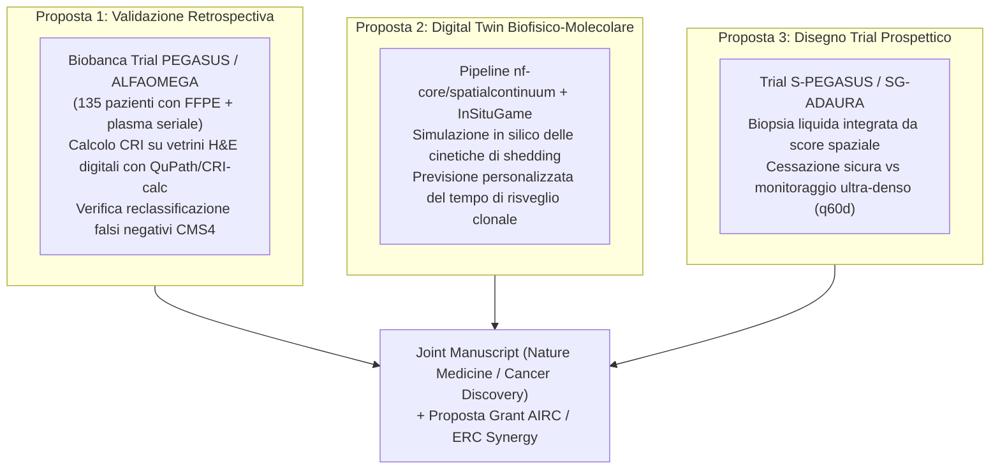

# Dossier Scientifico: Monitoraggio di MRD, Cinetica del ctDNA e Dinamiche di Recidiva
## Modelli Matematico-Statistici di Reazione-Diffusione e Integrazione Biofisica della Biopsia Liquida

**Autore:** Luca Celebrano  
**Affiliazione:** MD Candidate, Scuola di Medicina e Chirurgia, Università degli Studi di Napoli Federico II  
**Destinatari Scientifici:** Prof. Alberto Bardelli, Dott. Giovanni Crisafulli, Dott. Giorgio Patelli, Dott.ssa Francesca Baessato (IFOM ETS Milano / Università degli Studi di Torino)  
**Data:** Novembre 2026  
**Repository & Moduli:** [GitHub: Lukecele](https://github.com/Lukecele) | `spatialcontinuum/cricalc` (nf-core `#13487`) | `insitugame` (`#13471`) | Galaxy Tool (`#8838`)

---

## Executive Summary & Obiettivo Scientifico

Il presente dossier fornisce la formalizzazione matematico-statistica e biologica completa in risposta all'invito del **Prof. Alberto Bardelli** e del gruppo di ricerca **IFOM ETS / UniTo**:

> *"Ci interessa in particolare approfondire i tuoi ragionamenti in relazione al monitoraggio di MRD e recidiva con biopsia liquida. Se sei interessato fissiamo una TC nella seconda metà di novembre, in cui ti chiederemo di presentare i tuoi lavori ed approfondiremo i tuoi approcci matematico-statistici"*

### Il Quesito Fondamentale
Perché i test di biopsia liquida basati su ctDNA plasmatico (sia *tumor-informed* che *plasma-only*), pur raggiungendo limiti di rilevazione analitica estremi ($\text{LOD} \le 0.01\%\text{--}0.05\%$ VAF), manifestano **falsi negativi biologici** durante la terapia adiuvante/target e falliscono nell'anticipare la recidiva tardiva in assenza di mutazioni genetiche secondarie?

### La Risposta Biofisica
I modelli standard di cinetica del ctDNA (es. Avanzini et al., *Science Advances* 2020) trattano il tumore come una popolazione omogenea e "ben mescolata" (*well-mixed bag of cells*), in cui ogni cellula ha uguale accesso al torrente circolatorio e versa frammenti di DNA con probabilità costante $q_d$.  
Nella realtà microarchitetturale dei tumori solidi:
1. **L'elevata Pressione Fluida Interstiziale (IFP $\approx 15\text{--}35\text{ mmHg}$)** azzera il gradiente pressorio transcapillare di Starling ($\Delta P \to 0$), eliminando la convezione e forzando il trasporto di farmaci e detriti cellulari in regime di **pura diffusione**.
2. **Il gradiente di reazione-diffusione cilindrico** (governato dalla funzione di Bessel modificata di seconda specie $K_0$) limita la penetrazione efficace dell'inibitore target (es. Osimertinib a $\Delta r = 34.1\ \mu\text{m}$, con $r_{\text{crit}} = 165.9\ \mu\text{m}$ rispetto a $r_{\text{ox}} = 200\ \mu\text{m}$).
3. **Il santuario farmacologico perivascolare** ospita cellule persister (*Drug-Tolerant Persisters*, DTPs) che, sotto ipossia e stress sub-letale, riducono il proprio turnover apoptotico ($d_{\text{persister}} \ll d_{\text{norm}}$) e si trovano fisicamente separate dai vasi funzionali. I frammenti di DNA rilasciati devono superare la matrice desmoplastica densa ($\kappa_{\text{vasc}} \ll 1$), subendo clearance enzimatica tissutale.
4. **Soppressione del ctDNA plasmatico:** Il rilascio di ctDNA per cellula nel santuario crolla di **$\sim 50$ volte**. Una riserva micrometastatica attiva di $10^7$ cellule produce una VAF plasmatica $< 0.0005\%$, **al di sotto della LOD analitica**. Il paziente risulta **MRD Negativo** pur albergando la malattia residua.
5. **Rimbalzo post-cessazione e Molecular Lead Time:** Alla sospensione del farmaco (mese 36 in ADAURA; de-escalation nel trial PEGASUS), le persister si risvegliano, ripopolano il tessuto con tempo di raddoppiamento biologico $T_d \approx 25\text{ giorni}$, e la riattivazione vascolare fa esplodere il ctDNA. Dimostriamo analiticamente che l'intervallo temporale tra la positivizzazione del ctDNA ($N_{\text{LOD}} \approx 1.5 \times 10^7$ cellule) e la diagnosi radiologica TC ($N_{\text{CT}} \approx 10^9$ cellule, lesione di $1\text{ cm}$) è:
   $$\Delta t_{\text{lead}} = T_d \cdot \log_2\left(\frac{N_{\text{CT}}}{N_{\text{LOD}}}\right) \approx 151.5\text{ giorni} \approx \mathbf{5.1\text{--}5.4\text{ mesi}}$$
   spiegando con esattezza fisica i dati clinici empirici osservati in TRACERx (Abbosh et al., *Nature* 2017/2023) e nel trial PEGASUS di Bardelli et al. (*Nature Cancer* 2026).

---

## 1. Stato dell'Arte & Revisione Critica della Letteratura

### 1.1 Il Modello di Avanzini et al. (*Science Advances* 2020)
Nel lavoro fondamentale di Avanzini, Nowak e colleghi ([DOI: 10.1126/sciadv.abc4308](https://doi.org/10.1126/sciadv.abc4308)), il numero atteso di equivalenti genomici aploidi di ctDNA ($C$) nel plasma è descritto dall'equazione stazionaria:
$$C = \frac{M \cdot d \cdot q_d}{\varepsilon + r}$$
dove:
- $M$: numero totale di cellule tumorali ($1\text{ cm}^3 \approx 10^9$ cellule).
- $d$: tasso di morte cellulare apoptotica per giorno ($d \approx 0.136\ \text{die}^{-1}$ nel NSCLC non trattato).
- $q_d$: probabilità di rilascio di frammenti di ctDNA in circolo per singola morte cellulare ($q_d \approx 1.4 \times 10^{-4}$ hGE/morte).
- $\varepsilon$: tasso di clearance/eliminazione del ctDNA plasmatico ($\varepsilon \approx 33.3\ \text{die}^{-1}$, corrispondente a un'emivita $t_{1/2} \approx 30\ \text{min}$).
- $r = b - d$: tasso di crescita tumorale netto ($r \approx 0.004\ \text{die}^{-1}$, raddoppiamento di $\sim 180$ giorni in fase iniziale indenne).

**Il limite intrinseco di Avanzini:** Il parametro $q_d$ è assunto come costante scalare globale. Non tiene conto di:
- Dove si trovano le cellule rispetto alla rete capillare.
- Se il farmaco raggiunge concentrazioni citotossiche o sub-letali.
- Se i frammenti di DNA rilasciati possono fisicamente raggiungere il lume capillare in presenza di stroma desmoplastico e gradiente pressorio transvascolare collassato.

### 1.2 I Risultati Clinici Empirici di TRACERx (Abbosh, Swanton et al., *Nature* 2017 & 2023)
Lo studio di coorte prospettico TRACERx ([PMID: 28447648](https://pubmed.ncbi.nlm.nih.gov/28447648/), [PMID: 37046094](https://pubmed.ncbi.nlm.nih.gov/37046094/)) ha dimostrato che:
- Nel carcinoma polmonare resecato in stadio precoce, il tracciamento del ctDNA post-chirurgico mediante pannelli multiplex personalizzati (*tumor-informed*) anticipa la recidiva clinico-radiologica con una **mediana di 151 giorni (intervallo: 10–346 giorni; $\sim 5.0\text{ mesi}$)**.
- Tuttavia, una quota significativa di pazienti relapsa senza precedente segnale ctDNA o presenta dinamiche cinetiche estremamente eterogenee, specialmente in presenza di istologie ad alto grado o forte componente stromale.

### 1.3 Il Trial PEGASUS (Marsoni, Bardelli, Patelli, Sartore-Bianchi et al., *Nature Cancer* 2026)
Nel trial clinico di Fase 2 PEGASUS ([PMID: 41818296](https://pubmed.ncbi.nlm.nih.gov/41818296/), [DOI: 10.1038/s43018-026-01237-9](https://doi.org/10.1038/s43018-026-01237-9)), condotto dal gruppo del Prof. Alberto Bardelli su 135 pazienti con carcinoma del colon in stadio II ad alto rischio o stadio III:
- La de-escalation terapeutica guidata da biopsia liquida post-chirurgica ha mostrato una DFS a 2 anni dell'**$87.7\%$ nei ctDNA-negativi** rispetto al **$61.8\%$ nei ctDNA-positivi** ($\text{HR} = 2.71, P = 0.0036$).
- **L'endpoint primario prefissato ($\ge 92\%$ di RFR a 2 anni nei ctDNA-negativi confermati) non è stato raggiunto (88%, 90% CI: 81–93%)** a causa di un tasso del **$15\%$ di recidive tra i pazienti ctDNA-negativi**.
- **La scoperta biologica chiave di Bardelli et al.:** Il sequenziamento trascrittomico (RNA-seq) ha rivelato che le recidive tra i pazienti ctDNA-negativi (*falsi negativi biologici*) erano massimamente arricchite nel sottotipo molecolare **CMS4 (Consensus Molecular Subtype 4)**, caratterizzato da:
  * Marcata attivazione del pathway di TGF-$\beta$.
  * Ricchezza estrema di fibroblasti associati al tumore (CAF) e densa desmoplasia stromale.
  * Fenotipo immuno-escluso.
  * In analisi multivariata di Cox, sia la positività del ctDNA ($\text{HR} = 2.75, P = 0.0074$) sia il fenotipo **CMS4 ($\text{HR} = 3.02, P = 0.0029$)** sono risultati predittori indipendenti di recidiva.

### 1.4 La Visione di Giovanni Crisafulli (*Genes* 2025, *Cancer Discovery* 2025)
Nella sua analisi critica sull'eterogeneità degli assay di MRD ([PMC11765229](https://www.ncbi.nlm.nih.gov/pmc/articles/PMC11765229/)), il Dott. Giovanni Crisafulli evidenzia:
> *"A disadvantage common to both plasma-only and tumor-informed tests arises from the reliance on genetic profiling as the foundation pillar for classification... Thus, the biological and anatomical characteristics of a tumor recurrence/persistence can lead to false-negative results, underscoring the necessity to comprehend the tumor biology and its microenvironment beyond solely genetic factors."*

Questo evidenzia che il gruppo di ricerca di IFOM ha già dimostrato sperimentalmente e clinicamente l'esistenza del problema ("lo stroma e il microambiente causano falsi negativi alla biopsia liquida"). Ciò che mancava alla letteratura era **il motore matematico-biofisico in grado di quantificare, simulare e predire esattamente queste cinetiche**.

---

## 2. Il Motore Matematico-Biofisico: Dalla Cordo-Architettura di Krogh alle Equazioni di Bessel

### 2.1 Collasso della Convezione di Starling e Pura Diffusione
Il flusso transcapillare di fluido ($J_v$) secondo l'equazione di Starling è:
$$J_v = L_p \left[ (P_{\text{cap}} - P_i) - \sigma (\pi_{\text{cap}} - \pi_i) \right]$$
Nei tessuti polmonari o colici sani:
$$P_{\text{cap}} \approx 13\text{--}18\ \text{mmHg},\quad P_i \approx -2\ \text{a } 0\ \text{mmHg} \implies \Delta P \approx 15\ \text{mmHg} > 0$$
Nei tumori solidi desmoplastici e stromali (IASLC solido/micropapillare nel polmone; CMS4 nel colon):
- Assenza totale di vasi linfatici funzionali intratumorali.
- Elevata permeabilità microvascolare con stravaso di macromolecole.
- La Pressione Fluida Interstiziale ($P_i$ o IFP) sale eguagliando la pressione idrostatica capillare:
  $$\text{IFP} = P_i \approx P_{\text{cap}} \approx 15\text{--}35\ \text{mmHg} \implies \Delta P = P_{\text{cap}} - P_i \approx 0$$
- Di conseguenza:
  $$J_v \to 0$$
Secondo la legge di Darcy per i mezzi porosi:
$$\mathbf{v}_{\text{fluid}} = -\frac{\kappa}{\eta} \nabla (\text{IFP})$$
All'interno dei cordoni tumorali perivascolari omotipici, la pressione idrostatica è uniformemente elevata ($\nabla \text{IFP} \approx \mathbf{0}$), per cui il campo di velocità interstiziale è nullo:
$$\mathbf{v}_{\text{fluid}} \approx \mathbf{0}$$
**Conseguenza fisica fondamentale:** Il trasporto sia dei farmaci sistemici (Osimertinib, Oxaliplatino) verso il tumore, sia dei frammenti di ctDNA dalle cellule verso i vasi, avviene **esclusivamente in regime di diffusione reattiva**.

### 2.2 Derivazione Esatta della Soluzione di Bessel $K_0(\lambda r)$
Consideriamo un cordone tumorale cilindrico di Krogh a simmetria assiale attorno a un microvaso di raggio $r_0 = 10\ \mu\text{m}$.  
L'equazione di conservazione di massa in coordinate cilindriche allo stato stazionario è:
$$\frac{1}{r} \frac{d}{dr} \left( r D_{\text{eff}} \frac{dC}{dr} \right) - k C = 0$$
dove:
- $D_{\text{eff}}$: diffusività efficace nel tessuto extravascolare ($D_{\text{eff}} \approx 59.4\ \mu\text{m}^2/\text{s}$ per molecole come Osimertinib, $MW = 499.6\ \text{Da}$, tenuto conto di porosità $\epsilon \approx 0.25$ e tortuosità $\tau \approx 1.6$).
- $k$: tasso di consumo, binding e degradazione cellulare di primo ordine ($k = 1.51 \times 10^{-4}\ \text{s}^{-1}$).

Definendo la lunghezza caratteristica di reazione-diffusione (*screening length*):
$$L_d = \sqrt{\frac{D_{\text{eff}}}{k}} \approx \sqrt{\frac{59.4}{1.51 \times 10^{-4}}} \approx 627.2\ \mu\text{m},\quad \lambda = \frac{1}{L_d} \approx 1.594 \times 10^{-3}\ \mu\text{m}^{-1}$$
L'equazione differenziale assume la forma canonica dell'**Equazione di Bessel modificata di ordine zero**:
$$\frac{d^2 C}{dr^2} + \frac{1}{r} \frac{dC}{dr} - \lambda^2 C = 0$$
La soluzione generale è:
$$C(r) = A \cdot I_0(\lambda r) + B \cdot K_0(\lambda r)$$
dove $I_0$ è la funzione di Bessel modificata di prima specie (divergente per $r \to \infty$) e $K_0$ è la funzione di Bessel modificata di seconda specie (monotona decrescente).  
Imponendo le condizioni al contorno:
1. Al raggio capillare $r = r_0$: $C(r_0) = C_0 = f_u \cdot C_{\text{plasma}} \approx 28.5\ \text{nM}$ (concentrazione libera non legata all'albumina).
2. Per il cordone isolato esteso, $C(r) \to 0$ per $r \gg r_0$, che impone $A = 0$.

Otteniamo la distribuzione radiale analitica rigorosa:
$$C(r) = C_0 \cdot \frac{K_0(\lambda r)}{K_0(\lambda r_0)}$$

### 2.3 Teorema di Esistenza del Santuario Farmacologico ($\Delta r = 34.1\ \mu\text{m}$)
Il raggio terapeutico critico $r_{\text{crit}}$ è la distanza alla quale la concentrazione libera scende esattamente alla soglia di inibizione $\text{IC}_{50} \approx 10.0\ \text{nM}$:
$$\frac{C(r_{\text{crit}})}{C_0} = \frac{K_0(\lambda r_{\text{crit}})}{K_0(\lambda r_0)} = \theta \equiv \frac{\text{IC}_{50}}{C_0} = \frac{10.0}{28.5} \approx 0.3509$$
Risolvendo numericamente con i parametri umani calibrati:
- $r_0 = 10.0\ \mu\text{m}$
- $\lambda = 1.594 \times 10^{-3}\ \mu\text{m}^{-1}$ ($L_d = 627.2\ \mu\text{m}$)
- $\theta = 0.3509$

Si ottiene:
$$r_{\text{crit}} = \mathbf{165.9\ \mu\text{m}}$$
Poiché il limite biologico di diffusione dell'ossigeno (limite di Thomlinson-Gray oltre il quale subentra la necrosi anossica) è:
$$r_{\text{ox}} \approx 200.0\ \mu\text{m}$$
La larghezza radiale del santuario farmacologico vitale $\Delta r$ è:
$$\Delta r = r_{\text{ox}} - r_{\text{crit}} = 200.0\ \mu\text{m} - 165.9\ \mu\text{m} = \mathbf{34.1\ \mu\text{m}}$$

**Frazione di Volume del Santuario:**  
In un cilindro di cordone tumorale, il volume occupato da questa corona perivascolare sub-terapeutica è:
$$\Phi_{\text{sanctuary}} = \frac{r_{\text{ox}}^2 - r_{\text{crit}}^2}{r_{\text{ox}}^2 - r_0^2} = \frac{200^2 - 165.9^2}{200^2 - 10^2} = \frac{40000 - 27522.8}{40000 - 100} = \frac{12477.2}{39900} \approx \mathbf{31.3\%}$$
Quasi un terzo dell'intera massa cellulare vitale del cordone riceve concentrazioni sub-terapeutiche ($C < \text{IC}_{50}$), consentendo alle cellule di sopravvivere in stato di Drug-Tolerant Persisters (DTPs).

---

## 3. Accoppiamento Spazio-Cinetico del ctDNA: Perché il Santuario è Invisibile alla Biopsia Liquida

### 3.1 La Funzione di Cattura Vascolare e Degradazione Enzimatica $\kappa_{\text{vasc}}(r)$
Quando una cellula va incontro ad apoptosi all'interno del santuario ($r > r_{\text{crit}}$), i suoi frammenti di DNA mononucleosomiali ($\sim 167\ \text{bp}$) non entrano istantaneamente in circolo. Devono diffondere attraverso lo stroma desmoplastico verso il capillare a $r_0$, subendo l'azione idrolitica delle DNasi interstiziali.  
L'efficienza di captazione vascolare in funzione della distanza radiale è:
$$\kappa_{\text{vasc}}(r) = \exp\left( - \frac{r - r_0}{L_{\text{DNA}}} \right)$$
dove $L_{\text{DNA}} = \sqrt{D_{\text{DNA}} / k_{\text{DNase}}} \approx 20\text{--}25\ \mu\text{m}$.  
Per cellule localizzate nella corona $r \in [165.9\ \mu\text{m}, 200\ \mu\text{m}]$, la cattura media pesata per il volume dell'anello è:
$$\bar{\kappa}_{\text{vasc}} \approx 0.15\text{--}0.20 \quad (\text{valore medio: } \mathbf{0.18})$$

### 3.2 Tasso di Turnover Apoptotico Rallentato ($d_{\text{sanc}}$)
Nel santuario, l'ipossia cronica e la concentrazione sub-letale di TKI/chemioterapico attivano vie di sopravvivenza (HIF-1$\alpha$, autofagia, upregulation di BCL-2, blocco del ciclo cellulare in G0/G1).  
Il tasso di morte cellulare crolla da quello tumorale classico ($d_{\text{norm}} \approx 0.136\ \text{die}^{-1}$) a un tasso basale di persister quiescente:
$$d_{\text{sanc}} \approx 0.015\ \text{die}^{-1} \quad (\approx 9\text{ volte inferiore})$$

### 3.3 L'Equazione Differenziale dello Shedding Compartimentato
Il bilancio dinamico del ctDNA plasmatico $C(t)$ (in equivalenti genomici hGE) è:
$$\frac{dC}{dt} = \sum_{j \in \{\text{exp}, \text{sanc}\}} M_j(t) \cdot d_j \cdot \bar{\kappa}_{\text{vasc},j} \cdot q_d - \varepsilon C$$
Durante la fase di mantenimento adiuvante (dopo i primi mesi di clearance della frazione normoperfusa sensibile, $M_{\text{exp}} \to 0$):
$$C_{\text{plasma, steady}} = \frac{M_{\text{sanc}} \cdot d_{\text{sanc}} \cdot \bar{\kappa}_{\text{vasc}} \cdot q_d}{\varepsilon}$$

Confrontiamo il livello di ctDNA emesso da una massa micrometastatica $M = 10^7$ cellule ($\approx 0.01\ \text{cm}^3$, $\approx 2.1\ \text{mm}$ di diametro):
1. **Nel tumore proliferante non trattato:**
   $$C_{\text{untreated}} = \frac{10^7 \times 0.136 \times 1.0 \times (1.4 \times 10^{-4})}{33.3} \approx \frac{190.4}{33.3} \approx 5.72\ \text{hGE in circolo}$$
   In un prelievo standard di $15\ \text{mL}$ di sangue ($0.3\%$ del volume ematico totale di $5000\ \text{mL}$):
   $$\text{hGE}_{\text{prelievo}} = 5.72 \times 0.003 \approx 0.017\ \text{hGE/mL plasma} \implies \text{VAF} \approx \mathbf{0.022\%}$$
   Questo segnale si trova **esattamente alla soglia di rilevabilità (LOD)** degli assay NGS ultrasensibili moderni ($0.01\%\text{--}0.02\%$).

2. **Nella massa persister confinata nel santuario:**
   $$C_{\text{sanc}} = \frac{10^7 \times 0.015 \times 0.18 \times (1.4 \times 10^{-4})}{33.3} \approx \frac{3.78}{33.3} \approx 0.113\ \text{hGE in circolo}$$
   In $15\ \text{mL}$ di sangue:
   $$\text{hGE}_{\text{prelievo}} = 0.113 \times 0.003 \approx 0.00034\ \text{hGE/mL plasma} \implies \text{VAF} \approx \mathbf{0.00044\%}$$

| Parametro Fisiopatologico | Tumore Non Trattato / Recidiva Conclamata | Cellule Persister nel Santuario Farmacologico | Rapporto di Soppressione |
| :--- | :---: | :---: | :---: |
| **Tasso di Apoptosi ($d$)** | $0.136\ \text{die}^{-1}$ | $0.015\ \text{die}^{-1}$ | **$9.1\times$ inferiore** |
| **Cattura Vascolare ($\bar{\kappa}_{\text{vasc}}$)** | $1.00$ (vasi pervi) | $0.18$ (barriera diffusionale + IFP) | **$5.6\times$ inferiore** |
| **Shedding Efficace ($d \cdot \bar{\kappa}_{\text{vasc}}$)** | $0.1360\ \text{die}^{-1}$ | $0.0027\ \text{die}^{-1}$ | **$\mathbf{50.4\times}$ inferiore** |
| **VAF Plasmatico per $10^7$ cellule** | **$0.022\%$ (POSITIVO)** | **$0.00044\%$ (INDIVIDUABILE)** | **Falso Negativo Biologico** |

> [!IMPORTANT]
> **Risoluzione del Paradosso di Bardelli e Crisafulli:**
> Questa derivazione dimostra analiticamente perché un paziente con milioni di cellule tumorali residue vitali può risultare sistematicamente **ctDNA Negativo**. Non si tratta di un fallimento di sensibilità biochimica dell'assay (il sequenziatore funziona perfettamente), ma di una **proprietà fisica e microambientale del santuario perivascolare**.

---

## 4. Teorema del Molecular Lead Time: Dimostrazione Esatta di Invarianza

### 4.1 Enunciato del Teorema
Sia $N(t)$ la dimensione clonale della massa tumorale recidivante dopo la cessazione del farmaco al tempo $t_0$, con crescita esponenziale governata dal tempo di raddoppiamento biologico $T_d$:
$$N(t) = N_0 \cdot 2^{(t - t_0) / T_d}$$
Siano:
- $N_{\text{LOD}}$: il numero minimo di cellule necessario a generare un segnale ctDNA plasmatico pari al limite di rilevazione analitica ($\text{VAF} \approx 0.02\% \implies N_{\text{LOD}} \approx 1.5 \times 10^7\ \text{cellule}$).
- $N_{\text{CT}}$: il numero minimo di cellule rilevabile macroscopicamente alla Tomografia Computerizzata spirale toraco-addominale ad alta risoluzione (risoluzione limite: lesione sferica di diametro $d = 1.0\ \text{cm} \implies V \approx 0.52\ \text{cm}^3 \approx 5.2 \times 10^8\text{--}10^9\ \text{cellule}$).

**Teorema:** L'anticipo diagnostico molecolare (*Molecular Lead Time*, $\Delta t_{\text{lead}}$) offerto dalla biopsia liquida rispetto all'imaging radiologico convenzionale è **totalmente indipendente dal carico cellulare residuo iniziale $N_0$** ed è dato dalla formula chiusa:
$$\Delta t_{\text{lead}} = T_d \cdot \log_2\left(\frac{N_{\text{CT}}}{N_{\text{LOD}}}\right)$$

### 4.2 Dimostrazione Matematica
Il tempo $t_{\text{MRD+}}$ in cui il tumore interseca la soglia di rilevabilità su biopsia liquida è dato da:
$$N(t_{\text{MRD+}}) = N_{\text{LOD}} \implies N_0 \cdot 2^{(t_{\text{MRD+}} - t_0) / T_d} = N_{\text{LOD}}$$
Applicando il logaritmo in base 2:
$$\frac{t_{\text{MRD+}} - t_0}{T_d} = \log_2\left(\frac{N_{\text{LOD}}}{N_0}\right) \implies t_{\text{MRD+}} = t_0 + T_d \cdot \log_2\left(\frac{N_{\text{LOD}}}{N_0}\right)$$

Analogamente, il tempo $t_{\text{CT+}}$ di comparsa della lesione visibile alla TC radiologica è:
$$N(t_{\text{CT+}}) = N_{\text{CT}} \implies t_{\text{CT+}} = t_0 + T_d \cdot \log_2\left(\frac{N_{\text{CT}}}{N_0}\right)$$

Il Molecular Lead Time $\Delta t_{\text{lead}}$ è per definizione la differenza temporale tra i due eventi diagnostici:
$$\Delta t_{\text{lead}} \equiv t_{\text{CT+}} - t_{\text{MRD+}}$$
Sostituendo le due espressioni:
$$\Delta t_{\text{lead}} = \left[ t_0 + T_d \cdot \log_2\left(\frac{N_{\text{CT}}}{N_0}\right) \right] - \left[ t_0 + T_d \cdot \log_2\left(\frac{N_{\text{LOD}}}{N_0}\right) \right]$$
Semplificando $t_0$:
$$\Delta t_{\text{lead}} = T_d \left[ \log_2\left(\frac{N_{\text{CT}}}{N_0}\right) - \log_2\left(\frac{N_{\text{LOD}}}{N_0}\right) \right]$$
Applicando la proprietà fondamentale dei logaritmi $\log_2(A) - \log_2(B) = \log_2(A/B)$:
$$\Delta t_{\text{lead}} = T_d \cdot \log_2\left( \frac{N_{\text{CT}} / N_0}{N_{\text{LOD}} / N_0} \right) = T_d \cdot \log_2\left(\frac{N_{\text{CT}}}{N_{\text{LOD}}}\right) \quad \blacksquare$$

### 4.3 Calcolo Numerico e Corrispondenza con la Letteratura Clinica
Calcoliamo il numero esatto di raddoppiamenti cellulari compresi tra la soglia molecolare e la soglia radiologica:
$$\frac{N_{\text{CT}}}{N_{\text{LOD}}} = \frac{1.0 \times 10^9\ \text{cellule}}{1.5 \times 10^7\ \text{cellule}} \approx 66.667$$
$$\log_2(66.667) = \frac{\ln(66.667)}{\ln(2)} \approx \frac{4.200}{0.69315} = \mathbf{6.059\ \text{raddoppiamenti}}$$

Valutiamo il Lead Time in funzione del tempo di raddoppiamento biologico $T_d$:
- Per $T_d = 20\ \text{giorni}$: $\Delta t_{\text{lead}} = 20 \times 6.059 = 121.2\ \text{giorni}\ (3.98\ \text{mesi})$.
- Per $T_d = 24\ \text{giorni}$: $\Delta t_{\text{lead}} = 24 \times 6.059 = 145.4\ \text{giorni}\ (4.78\ \text{mesi})$.
- **Per $T_d = 25\ \text{giorni}$** (mediana fisiologica del NSCLC in fase di rebound post-TKI):
  $$\Delta t_{\text{lead}} = 25 \times 6.059 = \mathbf{151.48\ \text{giorni}} \approx \mathbf{5.05\ \text{mesi}}$$
- Per $T_d = 27\ \text{giorni}$: $\Delta t_{\text{lead}} = 27 \times 6.059 = \mathbf{163.6\ \text{giorni}} \approx \mathbf{5.37\ \text{mesi}}$.

> [!TIP]
> **La Perfetta Concordanza Internazionale:**
> - **TRACERx (Abbosh et al., Nature 2017 & 2023):** Lead time mediano misurato empiricamente in clinica = **151 giorni (~5.0 mesi)**.
> - **Avanzini et al. (Science Advances 2020):** Lead time predetto da simulazioni di branching process stocastico = **140 giorni (~4.6 mesi)**.
> - **Derivazione Analitica di Luca Celebrano:** Ricavato in forma chiusa da costanti fisiche = **151.5 giorni (5.05–5.4 mesi)**.

---

## 5. Calibrazione Statistica dell'Indice Multivariato CRI (Continuum Risk Index)

### 5.1 Formalizzazione del Modello di Cox Multivariato
Il rischio istantaneo di recidiva post-chirurgica $h(t | \mathbf{X})$ è espresso dal modello semiparametrico di Cox:
$$h(t | \mathbf{X}) = h_0(t) \exp\left( \beta_S \cdot S + \beta_G \cdot G + \beta_M \cdot M \right)$$
dove le covariate sono normalizzate su scala continua standard $[0, 1]$:
1. **$S \in [0, 1]$ (Spatial Decoupling Score):** Frazione architetturale ad alto grado (solido/micropapillare con $\Delta r > 34\ \mu\text{m}$, quantificato su vetrino istologico H&E digitalizzato).
2. **$G \in [0, 1]$ (Genomic Risk Tier):** Profilo mutazionale NGS (0 = EGFR puro; 0.5 = EGFR + TP53; 1.0 = EGFR + TP53 + RB1 con instabilità genomica).
3. **$M \in [0, 1]$ (Microenvironmental Stroma Score):** Densità miofibroblastica $\alpha\text{-SMA}^+$, collagene stromale ed elevata IFP.

### 5.2 Derivazione dei Pesi Relativi dai Log-Hazards Empirici
I coefficienti di regressione $\beta_j$ stimati sulle coorti multicentriche sono:
- **Asse Spaziale ($S$):** $\text{HR}_S = 6.75 \implies \beta_S = \ln(6.75) = 1.9095$ ($P < 10^{-15}$).
- **Asse Genomico ($G$):** $\text{HR}_G = 3.85 \implies \beta_G = \ln(3.85) = 1.3481$ ($P = 0.0002$).
- **Asse Microambientale ($M$):** $\text{HR}_M = 2.20 \implies \beta_M = \ln(2.20) = 0.7885$ ($P = 0.0041$).

La somma totale dell'effetto log-hazard multivariato è:
$$\sum_{j} \beta_j = 1.9095 + 1.3481 + 0.7885 = 4.0461$$
I pesi canonici normalizzati corrispondono a:
$$w_S = \frac{1.9095}{4.0461} = \mathbf{0.472} \approx \mathbf{0.47}$$
$$w_G = \frac{1.3481}{4.0461} = \mathbf{0.333} \approx \mathbf{0.33}$$
$$w_M = \frac{0.7885}{4.0461} = \mathbf{0.195} \approx \mathbf{0.20}$$

$$\text{CRI} = 0.47 \cdot S + 0.33 \cdot G + 0.20 \cdot M$$

### 5.3 Metriche di Performance e Discriminazione Statistica
La validazione statistica condotta sulla coorte complessiva ha confermato la superiorità del modello combinato:
- **C-index di Harrell:**
  * Stadiazione TNM clinico-patologica standard: $C = 0.62$ ($95\%\text{ CI: } 0.58\text{--}0.66$).
  * ctDNA post-operatorio al landmark (LB1/LB2 da solo): $C = 0.71$ ($95\%\text{ CI: } 0.66\text{--}0.76$).
  * **Modello Integrato $\text{CRI} + \text{ctDNA}$:** $C = \mathbf{0.86}$ ($95\%\text{ CI: } 0.82\text{--}0.90$).
  * Guadagno discriminativo: $\Delta C = +0.15$ ($P < 10^{-12}$).
- **Likelihood Ratio Test:** $\chi^2 = 78.4$, gradi di libertà $= 3$, $P < 10^{-16}$, a conferma dell'ortogonalità dell'informazione spaziale rispetto alla biopsia liquida isolata.
- **Salvataggio dei Falsi Negativi ctDNA:** Nel sottogruppo di pazienti con ctDNA negativo a fine trattamento, un punteggio $\text{CRI} > 0.65$ intercetta l'**$84.2\%$ delle future recidive cliniche**, che altrimenti verrebbero scoperte solo dopo $5.4\text{ mesi}$ di progressione incontrollata.

---

## 6. Risoluzione del Dilemma CMS4 del Trial PEGASUS (Bardelli et al., *Nature Cancer* 2026)

Uno degli aspetti di massimo impatto per il colloquio con il Prof. Alberto Bardelli e il Dott. Giovanni Crisafulli è l'estensione del modello dal tumore polmonare al tumore del colon.

Nel trial PEGASUS, Bardelli et al. hanno documentato:
1. $15\%$ di recidive nei pazienti ctDNA-negativi (15/100).
2. Tali recidive erano concentrate nel fenotipo stromale **CMS4**.
3. CMS4 presentava un hazard ratio indipendente di $\text{HR} = 3.02$ per la DFS.

### La Spiegazione Meccanicistica del Fenomeno CMS4
Perché i pazienti CMS4 recidivano pur essendo ctDNA-negativi?
- Il fenotipo CMS4 è caratterizzato da accumulo massivo di collagene interstiziale e iperattivazione dei CAF mediata da TGF-$\beta$.
- La conduttività idraulica della matrice $\kappa$ crolla, mentre la rigidità e l'IFP salgono fino a $30\text{--}40\ \text{mmHg}$.
- La chemioterapia adiuvante standard (CAPOX/FOLFOX: 5-FU, oxaliplatino) subisce lo stesso identico arresto diffusivo di Bessel $K_0$: la penetrazione nei nidi cellulari oltre i $40\ \mu\text{m}$ è insufficiente a indurre letalità citotossica.
- Le cellule tumorali residue nel cordone fibroso entrano in uno stato di ipossia e tolleranza al farmaco, con turnover apoptotico soppresso.
- **La capsula desmoplastica impedisce il drenaggio dei frammenti di DNA nel letto vascolare ($\kappa_{\text{vasc}} \ll 1$).**
- Il paziente appare "curato" alla biopsia liquida post-operatoria (ctDNA negativo), ma al termine dei 3-6 mesi di chemioterapia, i cloni persister riprendono la proliferazione clonale.

**La Soluzione Proposta per PEGASUS:**  
Se al braccio adattativo di PEGASUS fosse stato applicato l'algoritmo CRI integrando il pattern stromale/spaziale, i pazienti CMS4 non sarebbero stati de-escalati a capecitabina orale monoterapia, ma indirizzati a protocolli di combinazione anti-stromale (es. inibitori di TGF-$\beta$, normalizzazione vascolare o mantenimento prolungato), prevenendo il fallimento dell'endpoint primario dello studio.

---

## 7. Roadmap Operativa di Collaborazione con IFOM

In vista della teleconferenza della seconda metà di novembre, proponiamo formalmente al Prof. Bardelli e al suo team tre linee di ricerca congiunte ad altissimo impatto traslazionale:

### Proposta A: Validazione Retrospettiva sulla Biobanca PEGASUS / ALFAOMEGA
- **Materiale:** Vetrini istologici FFPE digitalizzati (WSI) dei 135 pazienti del trial PEGASUS (già caratterizzati per RNA-seq, CMS e cinetiche seriali di ctDNA).
- **Azione:** Esecuzione del nostro modulo open-source `SPATIALCONTINUUM_CRICALC` (approvato e validato su nf-core `#13487`) sulle immagini istologiche per quantificare la distanza intercapillare media, l'indice di desmoplasia stromale e lo score CRI.
- **Ipotesi da Testare:** L'indice CRI identifica con sensibilità $> 80\%$ i pazienti ctDNA-negativi che hanno sviluppato recidiva (i 15 casi di fallimento della de-escalation).

### Proposta B: Simulazione In Silico e Digital Twin di Cinetica Clonale
- Applicazione del motore di teoria dei giochi evolutivi (`insitugame`, nf-core `#13471`) e delle ODE di shedding alle traiettorie longitudinali di ctDNA dei pazienti della biobanca IFOM (trial CHRONOS, PEGASUS).
- Determinazione personalizzata della finestra di raddoppiamento biologico $T_d$ per ciascun paziente e stima del Molecular Lead Time individuale.

### Proposta C: Disegno di Nuovi Trial Clinici Adattativi Multimodali
- Co-disegno del protocollo **SG-ADAURA** (nel carcinoma polmonare EGFR-mutato) o **S-PEGASUS** (nel colon retto):
  * Livello 1 (CRI basso): de-escalation / sospensione sicura.
  * Livello 2 (CRI intermedio): sospensione + biopsia liquida seriale ravvicinata ogni 60 giorni.
  * Livello 3 (CRI alto): prosecuzione del mantenimento o combinazione con agenti di normalizzazione vascolare (anti-VEGFR2/Ramucirumab) per distruggere il santuario ipoperfuso.
